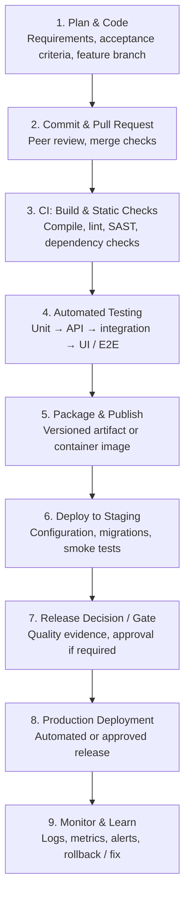

# CI, Continuous Delivery & Continuous Deployment — Interview Guide

For a **Senior Lead SDET / QA Lead interview**, you should understand not only what CI/CD means, but also how Development, QA, DevOps, and Operations share responsibility throughout the delivery pipeline.

The most important distinction to remember is:

- **CI (Continuous Integration):** Frequently integrate code and automatically validate changes.
- **Continuous Delivery:** Keep every validated change ready for release, with a human or business-controlled approval before production deployment.
- **Continuous Deployment:** Automatically release every change that passes the required quality and release gates to production.

## 1. CI vs Continuous Delivery vs Continuous Deployment

### 1. Continuous Integration (CI)

Developers frequently merge code into a shared branch. Each change triggers automated validation to identify defects early.

Typical checks: compile/build, unit tests, static analysis, API tests, and selected integration tests.

### 2. Continuous Delivery

Keep every change that passes the pipeline ready to deploy to production. Production release is possible at any time, but usually requires an explicit approval or business decision.

Typical checks: regression, end-to-end, security, performance, deployment validation, and release readiness.

### 3. Continuous Deployment

Every change that passes all required automated checks is automatically deployed to production without a routine manual release approval.

Typical safeguards: automated quality gates, canary releases, feature flags, monitoring, and automatic rollback or remediation.

> **Interview tip:** Continuous Deployment includes the automated release to production. Continuous Delivery ensures the software is always release-ready, but the production release can remain a manual decision.
>
> A team can practice CI without having mature Continuous Delivery or Continuous Deployment.

## 2. The complete CI/CD pipeline

Here is a typical application delivery flow. The exact stages vary by organization and architecture.

Notice that **testing is not a single stage performed only by QA**. Testing happens throughout development, integration, deployment, and production monitoring.

Also, a production deployment does not necessarily mean a feature is immediately available to all users. Feature flags and progressive rollout can control exposure.

## 3. Dev vs QA responsibilities across the entire pipeline

This is one of the most important areas for a Senior SDET interview.

| Pipeline stage | Developer responsibilities | QA / SDET responsibilities |
|---|---|---|
| 1. Requirement & design | Clarify requirements, technical design, testability | Review acceptance criteria, identify risks, define test strategy |
| 2. Coding | Implement features, write unit tests, handle edge cases | Identify test scenarios, prepare test data, design automation coverage |
| 3. Commit & PR | Follow coding standards, review code, fix defects | Review testability and automation impact; validate test changes |
| 4. Build & static checks | Resolve compilation, lint, and code-quality failures | Ensure relevant quality checks and test validations are included |
| 5. Unit & component tests | Write and maintain tests for individual components | Review coverage gaps; test critical boundary conditions and component behavior |
| 6. API & integration tests | Validate contracts, error handling, integrations | Automate API, schema, contract, and end-to-end integration tests |
| 7. UI / E2E regression | Fix application defects and provide stable test hooks | Own or co-own automation strategy, regression suites, flakiness management |
| 8. Staging deployment | Support configuration, migrations, environment issues | Execute smoke, sanity, deployment verification, and risk-based testing |
| 9. Release gate | Fix blocking defects and provide technical evidence | Evaluate quality evidence, report residual risk, recommend release readiness |
| 10. Production release | Support deployment, feature flags, rollback | Validate critical journeys, assess quality signals, support release verification |
| 11. Monitoring & feedback | Investigate logs, errors, performance, production defects | Analyze escaped defects, trends, customer-impacting failures, and improve coverage |

### Who owns what?

#### Development team

- Code quality and maintainability.
- Unit and component test coverage.
- Fixing defects and build failures.
- Application instrumentation, logs, and testability.
- Supporting safe deployments and recovery.

#### QA / SDET team

- Test strategy, risk analysis, and coverage.
- Automation frameworks and test reliability.
- API, UI, integration, E2E, and regression validation.
- Independent quality assessment and release-risk reporting.
- Quality metrics, defect analysis, and prevention.

#### DevOps / Platform / Operations

- Pipeline infrastructure and runner availability.
- Environment provisioning and deployment automation.
- Secrets, permissions, artifact registries, and infrastructure security.
- Monitoring, alerting, rollback mechanisms, and platform reliability.

> **Important leadership point:** Quality is a shared responsibility. QA should not be the sole owner of quality, and developers should not treat passing unit tests as proof that a feature is production-ready. The release owner or organization defines who has authority to approve a release.

## 4. Where do different tests fit into CI/CD?

A common interview question is: *“Will you execute all automation tests for every commit?”*

Usually, no. You choose test depth based on execution time, business risk, and feedback needs.

| Test type | Typical pipeline stage | Primary purpose |
|---|---|---|
| Linting and static analysis | Commit / PR | Detect coding issues early |
| Unit tests | Every PR / commit | Validate individual units quickly |
| API / contract tests | PR and integration | Validate service behavior and interfaces |
| Integration tests | CI / shared environment | Validate interactions between components |
| UI smoke tests | PR or post-deployment | Verify critical user journeys |
| Full E2E regression | Scheduled, release candidate, or risk-based CI | Validate business workflows across systems |
| Performance tests | Scheduled and release gates | Identify latency, throughput, and scalability risks |
| Security tests | Throughout CI/CD | Detect vulnerabilities and configuration risks |
| Accessibility tests | PR and regression pipeline | Detect accessibility issues |
| Production smoke / synthetic checks | After deployment | Verify real deployed behavior |

For a Playwright + TypeScript framework, for example:

- **PR pipeline:** lint, type-check, unit tests, API tests, and critical Playwright smoke tests.
- **Main branch pipeline:** broader API and UI regression, integration checks, and artifact creation.
- **Release pipeline:** deployment verification, risk-based regression, security/performance checks as appropriate, and production readiness.
- **Post-deployment:** smoke tests, synthetic monitoring, error-rate checks, and rollback triggers.

These are example policies, not universal rules. Some high-risk applications require more extensive validation before every release.

## 5. What is a Quality Gate?

A quality gate is an enforceable condition that must be satisfied before a pipeline can proceed.

### Pass

Required checks pass, reports are available, and the pipeline proceeds.

### Fail

A mandatory check fails. The pipeline blocks the merge, promotion, or deployment according to the configured policy.

### Inconclusive

A test times out, infrastructure fails, or evidence is missing. The gate should distinguish an infrastructure failure from an application defect rather than silently passing.

Examples of enforceable gates:

- Build and type-check must pass.
- All mandatory tests must pass.
- No open critical or blocker defects for the release scope.
- Required test results and reports must exist.
- Security findings must be within the approved risk policy.
- Performance must meet agreed service-level thresholds.
- Deployment health checks must pass before traffic is increased.

A gate should have an explicit owner, defined criteria, recorded evidence, and a clear failure path. Avoid relying on an unexplained “QA sign-off” as the only quality control.

## 6. Example: A developer commits code. What happens next?

Imagine a developer modifies the checkout feature in an e-commerce application.

1. **Developer pushes code.** A pull request is created. The CI pipeline starts automatically.
2. **CI validates the change.** Build, static analysis, unit tests, API tests, and critical automated UI tests execute.
3. **A checkout test fails.** The payment API returns an unexpected status code. The pipeline publishes the failure, logs, and test report.
4. **Dev and QA investigate.**
   - Developer checks the implementation, API response, and logs.
   - SDET checks the assertion, test data, service contract, and environment.
   - The team determines whether the cause is an application defect, test defect, or infrastructure issue.
5. **Fix, rerun, and proceed.** The fix is committed, affected tests rerun, and required gates must pass before promotion.
6. **Deploy and monitor.** The validated artifact is deployed according to the organization's delivery policy. Post-deployment checks verify that checkout works correctly.

Notice that **QA does not simply receive the build after development is finished**. QA contributes test design early, automation during development, quality gates during CI/CD, and production validation after release.

## 7. Continuous Delivery vs Continuous Deployment — practical example

Assume both teams have the same fully automated test pipeline.

| Event | Team A: Continuous Delivery | Team B: Continuous Deployment |
|---|---|---|
| Code passes CI | Build artifact | Build artifact |
| Regression passes | Artifact becomes release-ready | Artifact becomes release-ready |
| Staging checks pass | Wait for authorized release decision | Proceed automatically if all required gates pass |
| Production deployment | Triggered after approval | Triggered automatically |
| Production health check fails | Incident handling and rollback policy | Automated remediation or rollback where configured |

Both teams can deploy frequently. The difference is whether production deployment normally requires an explicit release decision after the pipeline succeeds.

Continuous Deployment does **not** mean deploying untested code. It depends on reliable automation, appropriate risk controls, and strong monitoring.

## 8. Frequently asked interview questions and answers

### 1. What is CI/CD?

CI/CD is a set of practices and automated processes that validate, package, deliver, and deploy software changes reliably and frequently. CI focuses on integration and automated validation; Continuous Delivery maintains release readiness; Continuous Deployment automatically releases qualifying changes to production.

### 2. What is the difference between CI and CD?

CI integrates and validates code changes frequently. CD can refer broadly to Continuous Delivery or Continuous Deployment. Continuous Delivery keeps software ready for release; Continuous Deployment automatically releases passing changes to production.

### 3. Who is responsible for quality in CI/CD?

Quality is shared. Developers own implementation quality and unit tests; QA/SDETs own or co-own test strategy, independent validation, automation, and risk reporting; platform teams support reliable pipelines and deployment infrastructure. The organization defines release authority.

### 4. Should all tests run on every commit?

No. Run fast, high-value checks early, such as linting, type checks, unit tests, and targeted API or UI tests. Run broader regression, expensive performance tests, and other checks at suitable stages based on risk and feedback time.

### 5. What happens when a pipeline fails?

The pipeline reports the failing stage and evidence. The team identifies whether the cause is an application defect, test defect, configuration issue, or infrastructure failure. Fix the cause, rerun the appropriate checks, and enforce the gate before proceeding.

### 6. What is the difference between a build and a deployment?

A build transforms source code into a usable artifact, such as a package or container image. Deployment installs or makes that artifact available in a target environment. A successful build does not prove that deployment or application behavior is correct.

### 7. How do you reduce flaky automation in CI/CD?

Use deterministic test data, isolated environments, stable locators, explicit state management, reliable test cleanup, useful logs and traces, and root-cause analysis. Retries can help diagnose intermittent failures, but must not hide real defects.

### 8. What metrics would you track as a QA Lead?

Track pipeline success rate, test duration, flaky-test rate, defect escape rate, change failure rate, deployment frequency, lead time for changes, recovery time, automation coverage by risk, and trends in failed quality gates. Define consistent measurement rules.

### 9. Can QA block a production release?

QA can enforce agreed automated quality gates and communicate risks. Whether QA can independently authorize or block a release depends on the organization's governance and release policy. Critical failures should not be bypassed without an explicit, auditable exception process.

### 10. What is shift-left testing?

Shift-left means moving quality activities earlier in the lifecycle: reviewing acceptance criteria, identifying risks during design, writing tests alongside implementation, and running fast automated checks on pull requests instead of waiting until the end.

### 11. What is shift-right testing?

Shift-right validates software in or after production using monitoring, synthetic tests, telemetry, canary analysis, and real-world behavior. It complements pre-release testing rather than replacing it.

### 12. How would you design a CI/CD pipeline as a Senior SDET?

Start with risk and feedback objectives. Define fast PR checks, layered automation, artifact immutability, environment promotion, enforceable quality gates, test reports, security checks, deployment verification, observability, and rollback procedures. Measure outcomes and improve the pipeline continuously.

## 9. A strong 60-second interview answer

> CI/CD is the practice of automating software integration, validation, delivery, and deployment.
>
> Continuous Integration ensures that code changes are frequently integrated and validated through automated builds, static analysis, unit tests, and integration tests.
>
> Continuous Delivery extends this process by keeping every validated change ready for production, with a release approval when required. Continuous Deployment goes one step further by automatically deploying every change that passes the required quality gates to production.
>
> From a QA and SDET perspective, our responsibility is not limited to executing regression tests at the end. We collaborate with developers from requirement analysis onward, design risk-based test coverage, implement reliable API and UI automation, integrate tests into the pipeline, enforce quality gates, and monitor quality after deployment.
>
> Developers remain responsible for code quality and unit testing, while QA provides broader quality validation and transparent risk assessment. DevOps and platform teams enable reliable infrastructure, deployment, monitoring, and recovery.
>
> As a Senior SDET, my goal is to provide fast feedback, prevent defects early, maintain trustworthy quality gates, and enable frequent releases without compromising product quality.

## 10. Quick revision: remember these distinctions

- **CI:** Is the change integrated and validated?
- **Continuous Delivery:** Is the change ready to release?
- **Continuous Deployment:** Has the passing change been automatically deployed to production?
- **Quality gate:** What evidence must pass before the next stage?
- **Dev:** Build the right software and test the implementation.
- **QA/SDET:** Establish confidence through risk-based validation and reliable automated evidence.
- **DevOps/Platform:** Make build, deployment, infrastructure, monitoring, and recovery reliable.
- **Shared ownership:** Quality is everyone's responsibility, even when individual release approvals have designated owners.

For your Senior Lead SDET preparation, focus especially on explaining **how you would design a risk-based pipeline, decide which Playwright tests run at each stage, prevent flaky tests from blocking delivery, and implement enforceable quality gates**. These demonstrate practical ownership beyond definitions.
