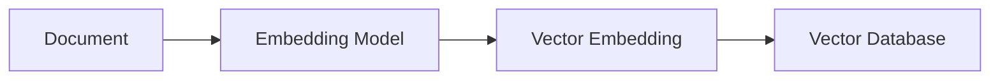
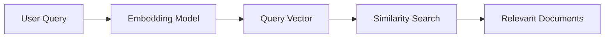
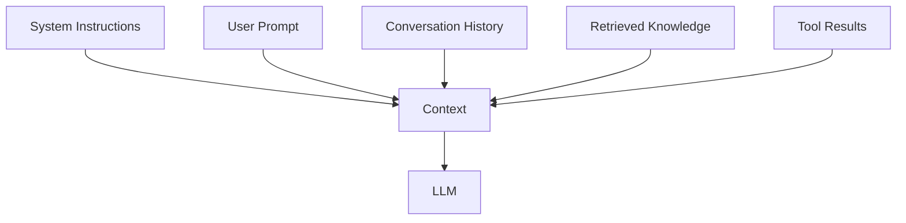
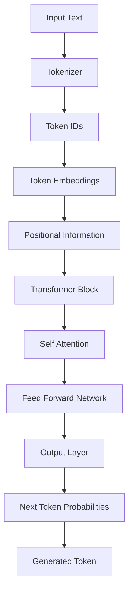
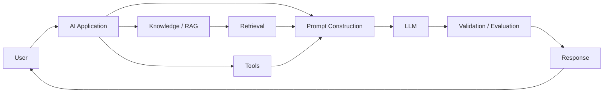
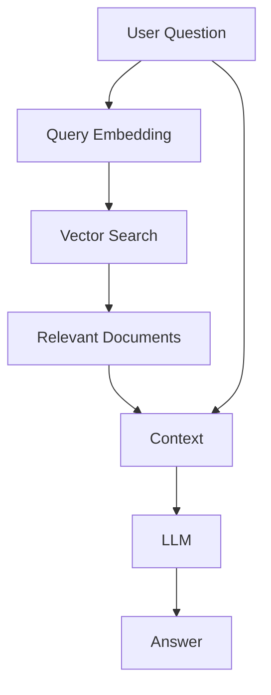
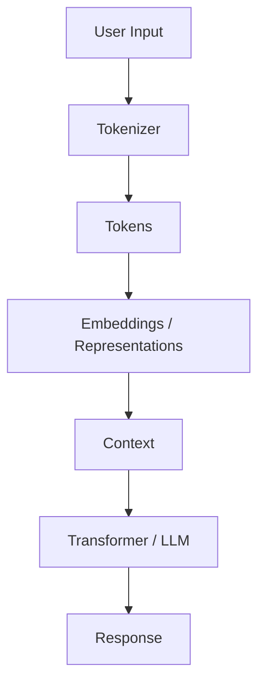
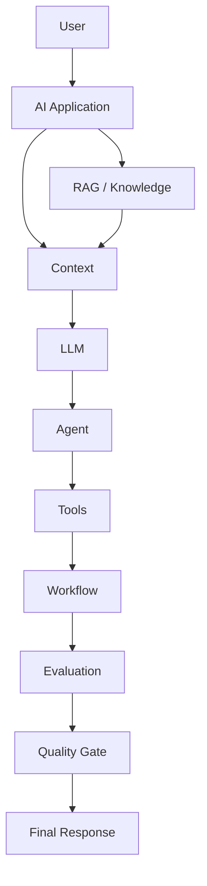

# AI & LLM Fundamentals for Senior Lead SDET

> A practical guide to understanding AI, LLMs, embeddings, context, attention, Transformers and AI application architecture from a Senior SDET / Quality Engineering perspective.

---

## Table of Contents

1. [Purpose](#1-purpose)
2. [AI vs ML vs Deep Learning vs Generative AI vs LLM](#2-ai-vs-ml-vs-deep-learning-vs-generative-ai-vs-llm)
3. [Tokens and Tokenization](#3-tokens-and-tokenization)
4. [Vectors](#4-vectors)
5. [Vectorization](#5-vectorization)
6. [Vector Embeddings](#6-vector-embeddings)
7. [Context](#7-context)
8. [Context Window and Context Size](#8-context-window-and-context-size)
9. [Context Lifetime](#9-context-lifetime)
10. [Attention Mechanism](#10-attention-mechanism)
11. [Attention Score](#11-attention-score)
12. [Transformer Architecture](#12-transformer-architecture)
13. [Large Language Models](#13-large-language-models)
14. [LLM Application Architecture](#14-llm-application-architecture)
15. [RAG](#15-rag)
16. [LangChain](#16-langchain)
17. [SDET Perspective](#17-sdet-perspective)
18. [AI Testing Cheat Sheet](#18-ai-testing-cheat-sheet)
19. [Final Mental Model](#19-final-mental-model)

---

# 1. Purpose

AI-related job descriptions increasingly mention:

- AI / ML
- LLM
- Generative AI
- LangChain
- RAG
- Embeddings
- Vector databases
- Agents
- MCP
- Agentic AI
- AI workflows
- Evals

A Senior SDET does not necessarily need to become an AI/ML researcher.

The more important objective is to understand **how AI systems work well enough to design, test, validate and govern them**.

The goal of this document is to build that foundation.

## Target Outcome

By the end, you should be able to explain:

```text
Text
 ↓
Tokens
 ↓
Token IDs
 ↓
Embeddings
 ↓
Context
 ↓
Transformer
 ↓
Attention
 ↓
LLM
 ↓
Response
```

And, at application level:

```text
User
 ↓
AI Application
 ↓
Context / RAG
 ↓
LLM
 ↓
Agent
 ↓
Tools / MCP / Connectors
 ↓
Workflow
 ↓
Validation / Evals
 ↓
Response
```

---

# 2. AI vs ML vs Deep Learning vs Generative AI vs LLM

These terms are related but are not interchangeable.

```text
Artificial Intelligence
│
└── Machine Learning
    │
    └── Deep Learning
        │
        └── Generative AI
            │
            └── Large Language Models
```

## Artificial Intelligence

AI is the broad field of creating systems capable of performing tasks that normally require some form of human intelligence.

Examples:

- Reasoning
- Classification
- Planning
- Perception
- Language understanding
- Decision making

---

## Machine Learning

Machine Learning allows systems to learn patterns from data instead of being explicitly programmed with every rule.

Traditional programming:

```text
Rules + Data
     ↓
   Program
     ↓
   Output
```

Machine learning:

```text
Data + Expected Results
          ↓
       Training
          ↓
        Model
          ↓
       Prediction
```

---

## Deep Learning

Deep Learning uses neural networks with many layers.

Examples:

- Image recognition
- Speech recognition
- Natural language processing
- Recommendation systems

---

## Generative AI

Generative AI produces new content.

Examples:

- Text
- Images
- Audio
- Video
- Code

An LLM is one type of Generative AI model.

---

## Large Language Model

An LLM is a model trained on large amounts of language data and capable of generating or transforming text.

Examples of tasks:

- Answering questions
- Summarization
- Translation
- Code generation
- Classification
- Reasoning
- Information extraction

### SDET Perspective

The important distinction is:

> **AI is the broader field; an LLM is one type of model used inside AI applications.**

---

# 3. Tokens and Tokenization

## What Is a Token?

A token is a unit of text processed by an LLM.

A token may correspond to:

- A word
- Part of a word
- Punctuation
- A number
- Special characters

For example:

```text
"Hello world"
```

Conceptually:

```text
Hello | world
```

But actual tokenization depends on the tokenizer and model.

---

## Why Do LLMs Use Tokens?

LLMs don't directly process human-readable sentences.

The general flow is:

```text
Human Text
    ↓
Tokenizer
    ↓
Tokens
    ↓
Token IDs
    ↓
Neural Network
```

For example:

```text
"Testing AI applications"
          ↓
       Tokenizer
          ↓
   [Testing] [AI] [applications]
          ↓
      Token IDs
```

---

## Input Tokens

Tokens sent to the model.

They can include:

```text
System Instructions
+
User Prompt
+
Conversation History
+
Retrieved Documents
+
Tool Results
```

---

## Output Tokens

Tokens generated by the model.

```text
Input Tokens
      +
Output Tokens
      =
Total Token Usage
```

Token usage can affect:

- Cost
- Latency
- Context limits
- Performance

---

## Tokenization Testing

A Senior SDET should consider:

### Boundary Tests

Test:

- Very short prompts
- Very long prompts
- Large documents
- Unicode
- Emojis
- Special characters
- Multiple languages
- Code
- JSON
- XML

### Example

```text
Input:
"Generate test cases for 😊 authentication."

```

Do not assume one character equals one token.

---

# 4. Vectors

A vector is an ordered collection of numerical values.

Example:

```text
[0.21, -0.43, 0.87, 0.15]
```

A vector can represent information in a numerical space.

Think of it as:

> A machine-readable numerical representation of something.

---

## Why Vectors Matter

Computers can mathematically compare vectors.

For example:

```text
Document A → [0.2, 0.7, 0.1]
Document B → [0.3, 0.6, 0.2]
Document C → [-0.8, 0.1, 0.9]
```

A similarity algorithm can determine which vectors are closer.

This becomes extremely useful for:

- Semantic search
- RAG
- Recommendations
- Document retrieval

---

# 5. Vectorization

Vectorization is the process of representing information numerically.

Conceptually:

```text
Text
 ↓
Processing
 ↓
Numerical Representation
 ↓
Vector
```

Example:

```text
"Playwright automation"
             ↓
        Vectorization
             ↓
[0.13, 0.82, -0.12, ...]
```

---

## Vector vs Vectorization vs Embedding

| Concept | Meaning |
|---|---|
| Vector | Numerical representation |
| Vectorization | Process of creating numerical representation |
| Embedding | Meaningful numerical representation learned by a model |
| Embedding Model | Model that creates embeddings |

---

# 6. Vector Embeddings

An embedding is a numerical representation of information designed to capture meaningful relationships.

For example:

```text
"car"
"automobile"
"vehicle"
```

may have embeddings that are relatively close in vector space.

Whereas:

```text
"car"
"database transaction"
```

would generally have less semantic similarity.

---

## Embedding Flow



For a query:



---

## Semantic Similarity

Traditional keyword search:

```text
"car"
```

looks primarily for matching terms.

Semantic search attempts to understand:

```text
car
automobile
vehicle
```

as related concepts.

---

## Cosine Similarity

A common way to compare vectors is cosine similarity.

Conceptually:

```text
Similarity
   ↑
   |
1.0|       A
   |      /
   |     /
   |    /
0.0|---/------------>
   |
-1.0|
```

You do not need to memorize the mathematics to test AI systems.

The important idea is:

> Higher similarity generally means the vectors point in more similar directions.

---

## Embedding Testing

A QE strategy should validate:

### Retrieval Relevance

Does the retrieved document actually relate to the question?

### Retrieval Recall

Was relevant information retrieved?

### Retrieval Precision

Were irrelevant documents avoided?

### Stale Embeddings

What happens when the source document changes but the embedding isn't updated?

### Duplicate Embeddings

What happens when the same document exists multiple times?

---

# 7. Context

Context is the information supplied to the model to help it generate a response.

It can contain:

```text
System Instructions
+
User Prompt
+
Conversation History
+
Retrieved Documents
+
Tool Results
+
Agent State
```

---

## Context Assembly



---

## Why Context Matters

Consider:

```text
User:
"Generate tests for this API."
```

Without context:

```text
LLM → Generic API tests
```

With context:

```text
API specification
+
Authentication requirements
+
Business rules
+
Existing test conventions
+
User request
        ↓
LLM
        ↓
Relevant tests
```

---

# 8. Context Window and Context Size

## Context Window

The context window is the amount of tokenized information a model can process within a particular request.

Conceptually:

```text
+----------------------------------------+
| System Instructions                    |
| User Prompt                            |
| Conversation History                   |
| Retrieved Documents                    |
| Tool Results                           |
| Agent State                            |
|                                        |
| Available Output Space                 |
+----------------------------------------+
```

---

## Context Window Is Not the Same as Memory

A large context window does not necessarily mean persistent memory.

Think:

```text
Context Window
=
What the model can see/use for this interaction
```

Whereas persistent memory is an application-level capability that may store information beyond a single request.

---

## Context Overload

More context does not automatically mean better results.

Example:

```text
10 relevant documents
        ↓
Good context
        ↓
Good response
```

versus:

```text
1,000 mostly irrelevant documents
        ↓
Huge context
        ↓
Potentially worse response
```

---

## Lost in the Middle

Relevant information buried inside a very large context may receive less effective use than expected.

Therefore:

> Context quality matters as much as context quantity.

---

## Context Testing

Test:

- Empty context
- Minimal context
- Maximum context
- Irrelevant context
- Conflicting context
- Duplicate context
- Outdated context
- Malicious context

---

# 9. Context Lifetime

Context can exist at multiple levels.

```text
Request
  │
  └── Request Context
        ↓
      Expires

Conversation
  │
  └── Conversation Context
        ↓
      May persist for conversation

Application
  │
  └── Persistent Knowledge / State
```

---

## Request Context

Exists for a specific request.

Example:

```text
Prompt
+
Retrieved Documents
+
Tool Results
```

---

## Conversation Context

May include previous messages.

```text
Message 1
   ↓
Message 2
   ↓
Message 3
   ↓
Current Message
```

---

## Persistent Knowledge

Stored outside the model itself.

Examples:

- Database
- Vector database
- Files
- Enterprise knowledge systems

---

## Context vs Memory vs Knowledge

| Concept | Meaning |
|---|---|
| Context | Information provided to the model |
| Memory | Information retained for future interactions |
| Knowledge | Information available from data sources |

These should be treated as separate concepts during testing.

---

# 10. Attention Mechanism

Attention is one of the key mechanisms behind Transformer models.

A simple analogy:

> When reading a sentence, you don't give every word equal importance. You focus more on words that help you understand the current word or idea.

---

## Example

```text
"The dog chased the ball because it was moving."
```

When interpreting:

```text
"it"
```

the model needs to understand which earlier words are relevant.

Attention allows relationships between tokens to be modeled.

---

## Conceptual Representation

```text
Token A
   │
   │ attention
   ▼
Token B

Token B
   │
   │ strong attention
   ▼
Token C
```

---

# 11. Attention Score

An attention score represents how much one token should focus on another token in a particular attention operation.

Conceptually:

```text
"The application failed because it timed out."
```

Possible conceptual relationships:

```text
"it" → "application"     High
"it" → "timed out"       High
"it" → unrelated token   Low
```

This is only an intuitive illustration.

---

## Query, Key and Value

Self-attention commonly uses:

```text
Query
Key
Value
```

Conceptually:

```text
Query
  ↓
"What information am I looking for?"

Key
  ↓
"What information do I contain?"

Value
  ↓
"What information should be provided?"
```

Attention scores help determine how much information should flow from different tokens.

---

## SDET Relevance

Understanding attention helps explain why:

- Context matters
- Word relationships matter
- Prompt structure matters
- Long context can become challenging
- Models can produce unexpected interpretations

You do not need to implement attention mathematics to test an LLM effectively.

---

# 12. Transformer Architecture

Transformers are the architecture behind modern LLMs.

A simplified flow:



---

## Token Embeddings

Tokens are converted into numerical representations.

```text
Token
 ↓
Embedding
 ↓
Vector
```

---

## Positional Information

Language depends on ordering.

Compare:

```text
"Dog bites man."
```

with:

```text
"Man bites dog."
```

The words are similar, but the meaning is different.

The model therefore needs information about token position/order.

---

# 13. Self-Attention

Self-attention allows tokens to consider other tokens within the sequence.

Conceptually:

```text
Token A ───────┐
Token B ───────┼──> Attention
Token C ───────┤
Token D ───────┘
```

Each token can consider relationships with other tokens.

---

# 14. Multi-Head Attention

Instead of having a single attention mechanism, Transformer architectures commonly use multiple attention heads.

Conceptually:

```text
Input
  │
  ├── Attention Head 1
  ├── Attention Head 2
  ├── Attention Head 3
  ├── Attention Head 4
  │
  └── ...
       ↓
Combined Representation
```

Different heads can learn different types of relationships.

---

# 15. Feed-Forward Network

After attention, information passes through feed-forward layers.

Conceptually:

```text
Input Representation
        ↓
Self Attention
        ↓
Feed Forward Network
        ↓
Updated Representation
```

Transformer blocks repeat this process many times.

---

# 16. Transformer Block

A simplified Transformer block:

```text
Input
 ↓
Attention
 ↓
Residual Connection
 ↓
Normalization
 ↓
Feed Forward
 ↓
Residual Connection
 ↓
Normalization
 ↓
Output
```

A large model can contain many such blocks.

---

# 17. Encoder vs Decoder

There are different Transformer architectures.

## Encoder

Generally designed to understand/represent input.

Useful for:

- Classification
- Embeddings
- Representation learning

---

## Decoder

Designed to generate sequences.

A decoder-only architecture is common in modern LLMs.

Conceptually:

```text
Prompt
 ↓
Model
 ↓
Predict next token
 ↓
Add token
 ↓
Predict next token
 ↓
...
```

---

## Encoder-Decoder

Useful for tasks involving transformation from one sequence to another.

Examples:

- Translation
- Text transformation

---

# 18. Large Language Models

An LLM learns patterns from large amounts of language data.

A simplified view:

```text
Training Data
     ↓
Training
     ↓
Model Parameters
     ↓
LLM
     ↓
Inference
```

---

## Training vs Inference

### Training

The model learns patterns.

### Inference

The trained model generates an answer for a new input.

For a QE engineer:

> Most application-level testing happens around inference and the surrounding AI system.

---

# 19. Next Token Prediction

A simplified LLM generation process:

```text
Input:
"The capital of France is"

Model predicts:

Paris
```

Then:

```text
"The capital of France is Paris"
```

The model predicts the next token again.

This continues until the generation ends.

---

# 20. Temperature

Temperature influences the randomness/variability of generation.

Conceptually:

```text
Lower temperature
    ↓
More predictable

Higher temperature
    ↓
More variability
```

It is important to understand that temperature alone does not guarantee deterministic behavior.

Other factors can affect output variability.

---

## SDET Testing

Run repeated evaluations:

```text
Same Input
   ↓
Run 1 → Output A
Run 2 → Output B
Run 3 → Output A
Run 4 → Output C
```

Evaluate whether all outputs satisfy the required behavior.

---

# 21. LLM Application Architecture

A real AI application is more than an LLM.



---

## Important Components

### Application

Controls the overall behavior.

### Prompt

Provides instructions.

### Knowledge

Provides external information.

### Retrieval

Finds relevant information.

### Tools

Allow the AI to perform actions.

### LLM

Generates or transforms information.

### Validation

Determines whether the result meets requirements.

---

# 22. RAG

RAG stands for:

> Retrieval-Augmented Generation.

Instead of expecting the model to know everything, the application retrieves relevant information and gives it to the model.



---

## Why RAG?

Suppose an organization has:

```text
Company Policies
API Documentation
Architecture Documents
Test Standards
Product Requirements
```

These may not be part of the model's training data.

RAG can retrieve relevant internal information.

---

## RAG Testing

A Senior SDET should test:

```text
Question
 ↓
Retrieval
 ↓
Context
 ↓
Generation
 ↓
Answer
```

At each stage ask:

1. Was the right document retrieved?
2. Was enough context retrieved?
3. Was irrelevant context included?
4. Did the model use the retrieved information?
5. Is the final answer grounded in the context?

---

# 23. LangChain

LangChain is an application framework/ecosystem used to build LLM-powered applications.

Conceptually it can help developers compose:

```text
Prompt
+
Model
+
Retriever
+
Tools
+
Agents
+
Application Logic
```

---

## Conceptual Architecture

```text
Application
    │
    ├── Prompt
    ├── Model
    ├── Retriever
    ├── Tools
    ├── Agent
    └── Workflow
```

The exact APIs and abstractions vary by framework/version.

The important architectural idea is:

> Frameworks help developers connect LLMs with application logic, data and tools.

---

# 24. LangChain vs LLM

They are not the same.

| LLM | LangChain |
|---|---|
| AI model | Application framework/ecosystem |
| Generates/processes content | Helps compose AI applications |
| Performs inference | Connects models with application components |
| Model layer | Application orchestration layer |

---

# 25. SDET Perspective

A Senior SDET should not only ask:

> "Does the LLM answer correctly?"

Instead ask:

```text
Is the prompt correct?
        ↓
Is the context correct?
        ↓
Is retrieval correct?
        ↓
Is the model appropriate?
        ↓
Is the tool selection correct?
        ↓
Are tool parameters correct?
        ↓
Is the workflow correct?
        ↓
Is the output correct?
```

This is the beginning of **AI Quality Engineering**.

---

# 26. AI Testing Cheat Sheet

| Area | Key Testing Question |
|---|---|
| Tokenization | Does the application handle token boundaries/limits? |
| Context | Is the right information supplied? |
| Context Window | What happens near limits? |
| Embeddings | Are semantic representations useful? |
| Retrieval | Are relevant documents retrieved? |
| Prompt | Does the prompt produce intended behavior? |
| LLM | Is the response correct and relevant? |
| RAG | Is the answer grounded in retrieved information? |
| Agent | Does it select the correct action? |
| Tool | Are inputs/outputs correct? |
| Workflow | Are steps executed correctly? |
| Security | Can malicious input bypass controls? |
| Evaluation | Does the result meet quality thresholds? |
| Regression | Did quality degrade after a change? |

---

# 27. Final Mental Model

The most useful mental model for a Senior SDET is:



At application level:



---

# 28. Key Takeaway

A Senior SDET does **not** need to become an AI researcher to become valuable in AI.

The important transition is:

```text
Traditional SDET
      ↓
Automation Architect
      ↓
AI-Aware SDET
      ↓
AI Quality Engineer
```

Your existing strengths in:

- Automation
- API testing
- Framework architecture
- CI/CD
- Test strategy
- Contract testing
- Integration testing
- Regression testing
- Quality gates

remain highly valuable.

The new concepts you need to add are:

```text
LLM
Tokens
Embeddings
Context
RAG
Agents
Tools
MCP
Workflows
Evals
Ground Truth
Drift
AI Observability
AI Quality Gates
```

That combination is what turns traditional Quality Engineering into **AI Quality Engineering**.

---
ChatGPT